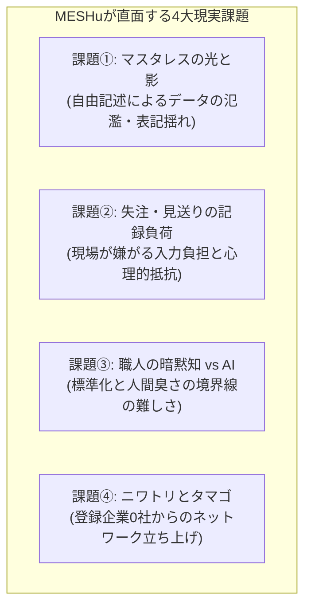

# MESHu 開発ロードマップ ―― マイナスからのスタート宣言
## Starting from Below Zero: Building the Decision Learning Infrastructure for Industry

> 「MESHuは単なる受発注インフラではなく、**『業界の意思決定を学習する基盤』**へと進化する」

---

## 1. 私たちの現在地：登録企業0社、マイナスからのスタート

2026年10月、私たちはオープンソースの次世代B2B受発注プラットフォーム「MESHu」を全世界へ公開しました。

現在の導入企業数は**「0社」**です。

実績もなければ、名声もありません。世の多くのスタートアップは完成された姿を演出し、成功を装いますが、私たちはあえて逆を行きます。

私たちのシステムは完成品どころか、現場の厳しい現実に直面すればするほど、**無数の未解決課題を抱えた「マイナスからのスタート」**です。失うものは何もありません。だからこそ、私たちは抱えている弱みと課題のすべてを白日の下に晒し、世界中の技術者や現場の皆様と共に、オープンな議論を通じてこの山を登る決意をここに宣言します。

---

## 2. 私たちが直面している「4つの未解決な現実課題」

MESHuが現場で十数年にわたり培ってきた思想の裏側には、解決すべき極めて泥臭く、しかし本質的な壁が存在します。



### 課題①：マスタレス（自由記述）の「光と影」
* **光:** 事前マスタ登録の呪縛（マスタ奴隷）を破壊し、初日から商流をデジタルで動かせる手軽さ。
* **影:** 自由記述を許容し続けると、表記揺れ（「SUS304」と「ステン304」など）や重複データが蓄積し、長期的なデータ分析が難しくなる。
* **問い:** 現場の手軽さを1ミリも殺さずに、蓄積された「混沌」からいかにして後から自動で「秩序」を抽出するか？

### 課題②：失注・見送り理由（負けのデータ）の記録負担
* **課題:** 受注データ（成功）だけを集めても片手落ち。「なぜ今回は相見積もりで負けたのか」「なぜ納期が合わなかったのか」という失注データにこそ、企業の意思決定の分岐点が詰まっている。
* **現実の壁:** 現場の営業や職人は、負けた理由や長文の反省文など絶対に書きたがらない。
* **問い:** 現場に負担を感じさせず、心理的抵抗を生まない「7割の雑さ（1クリック＋一言）」で、いかに失注文脈を吸い上げるか？

### 課題③：町工場の「職人技・暗黙知」と「AI自動化」の境界線
* **課題:** 切削工具や特殊加工の世界では、機械の剛性・被削材・職人の勘・長年の付き合いによる「生きた合意（無理の通し合い）」が不確実性への強力な保険として機能している。すべてを合理的なAIで自動化すれば、トラブル時に極めて脆いサプライチェーンになる。
* **問い:** 「AIが高速・透明に回すルーチン領域」と「人間が裁量を持って担う例外・創出領域」を、どのようにシステム境界として二層設計するか？

### 課題④：ニワトリとタマゴ（登録企業0社の立ち上げ）
* **課題:** 相手がいないネットワークには誰も参加しない。誰も参加しないから相手がいない。
* **問い:** ネットワーク効果が効かない初期段階において、1社単体でも導入する価値（手元の取引整理や受発注FAX代替ツールとしての価値）をどう提供できるか？

---

## 3. 課題を解く「3段階開発ロードマップ」

私たちは、これらの課題から目を背けず、以下の3段階のステップを踏んで着実にシステムを進化させます。

```
【Phase 1: 始動・接続の民主化（現在完了・稼働中）】
  ・「マスタ奴隷」の解放：自由記述で即日繋いで打ち込めるMVP基盤
  ・Laravel 12 × Docker による完全オープンソース（AGPLv3）の公開
  ・公式技術白書（White Paper v1.0）の策定と公開
  ・課題：登録企業0社、認知のゼロ地点

【Phase 2: 「生きた合意」と「曖昧さの軽い構造化」（直近の開発目標）】
  ・通常取引（ルーチン）と例外取引（職人的調整）のステータス二層化
  ・失注・見送り理由のワンクリック収集機能（価格／納期／仕様／関係性）
  ・現場が嫌がらない「7割の雑さ」で残す取引文脈ログ（意思決定ログ）の記録UI
  ・単体企業でも使えるCSVインポート・帳票出力機能の強化

【Phase 3: 自律分散型の経験学習ネットワーク（未来の産業OS）】
  ・蓄積された商流ログをDuckDBで串刺し分析（ボトルネック検知・離反予測）
  ・二者間インプロセス超分散（SQLite）による低炭素・局所隔離インフラへの移行
  ・業界特化ディストリビューション（MESHu Food / Build / Medical）のプラグイン開発
  ・特定企業の私有化を防ぐ非営利コンソーシアム「MESHu Foundation」の設立
```

---

## 4. 私たちが目指すゴール：業界の意思決定を学習する基盤へ

多くのITシステムは、単なる「伝票の置き換え（電子化）」で終わってしまいます。

しかし、MESHuが目指すゴールは違います。

日々の商流キャッチボール（商流ラリー）の中で、
- 「なぜこの条件で合意したのか」
- 「なぜ今回は失注したのか」
- 「職人がどの瞬間に無理を通したのか」

という**人間の生きた判断の足跡を、現場に負担をかけずに吸い上げ、蓄積していくこと**。

それが溜まったとき、MESHuは単なる受発注インフラを超え、**「過去の膨大な経験と文脈を学習し、次の一手を先回りして支援する、業界全体の意思決定学習基盤」**へと大化けします。

---

## 5. パイオニア（最初の仲間・第1号企業）の募集

私たちは今、ゼロどころかマイナスの地点に立っています。
しかし、この過酷な挑戦ほどエンジニアと事業家にとって面白いフロンティアはありません。

- **開発者（コントリビューター）の皆様へ:**
  - アーキテクチャの議論、コードのプルリクエスト、Issueでの課題提起を熱烈に歓迎します。
- **製造業・商流企業の皆様へ:**
  - 私たちと共に「マスタ奴隷」の苦しみから抜け出し、最初の実験台（第1号ユーザー）となってくださる現場の企業様を探しています。

ゼロから始めるこの泥臭い航海に、あなたの情熱を乗せてみませんか。

- **GitHub:** https://github.com/meshuoffice/MESHu-OSS
- **Portal:** https://meshu.org
- **White Paper:** https://meshu.org/whitepaper
- **Official 𝕏:** [@meshu_org](https://x.com/meshu_org)
