# MESHu データベース設計書

本ドキュメントは、MESHu（Laravel 12 / PostgreSQL 16+）におけるデータベース構造、ERダイアグラム、各テーブルのカラム定義、ENUM型、インデックス、および制約方針を定義したものです。

---

## 1. 全体ERダイアグラム（Mermaid）

```mermaid
erDiagram
    companies ||--o{ companies : "parent_id (親拠点/子会社)"
    companies ||--o{ users : "company_id"
    companies ||--o{ company_links : "buyer_company_id"
    companies ||--o{ company_links : "seller_company_id"
    companies ||--o{ invitations : "company_id (招待元)"
    companies ||--o| company_badges : "company_id"
    companies ||--o{ notices : "company_id (自社発信)"
    
    users ||--o{ user_assigned_links : "user_id"
    users ||--o{ invitations : "user_id (送信者)"
    users ||--o{ password_reset_tokens : "user_id"
    users ||--o{ notices : "created_by_user_id"
    users ||--o{ chat_read_statuses : "user_id"
    
    company_links ||--o{ user_assigned_links : "company_link_id"
    company_links ||--o{ chat_messages : "company_link_id"
    company_links ||--o{ chat_read_statuses : "company_link_id"
    
    owners ||--o{ company_badges : "verifier_owner_id"
    owners ||--o{ notices : "created_by_admin_id"

    company_links ||--o{ transactions : "company_link_id (ON DELETE CASCADE)"

    transactions ||--o{ transaction_histories : "transaction_id (ON DELETE CASCADE)"
    transactions ||--o{ transaction_items : "transaction_id (ON DELETE CASCADE)"
    transactions ||--o{ transaction_attachments : "transaction_id (ON DELETE CASCADE)"
    transactions ||--o{ transaction_comments : "transaction_id (ON DELETE CASCADE)"

    users ||--o{ transaction_histories : "user_id (ON DELETE SET NULL)"
    users ||--o{ transaction_attachments : "user_id (ON DELETE SET NULL)"
    users ||--o{ transaction_comments : "user_id (ON DELETE SET NULL)"
    users ||--o{ chat_messages : "user_id (ON DELETE CASCADE)"

    companies ||--o{ transaction_attachments : "company_id (ON DELETE CASCADE)"
    companies ||--o{ transaction_comments : "company_id (ON DELETE CASCADE)"
    companies ||--o{ chat_messages : "company_id (ON DELETE CASCADE)"

    notices ||--o{ notice_attachments : "notice_id (ON DELETE CASCADE)"
    chat_messages ||--o{ chat_message_attachments : "chat_message_id (ON DELETE CASCADE)"

    companies {
        int id PK "企業ID"
        int parent_id FK "親企業ID (自己参照)"
        int invitation_company_id "招待元企業ID"
        text url_code UK "専用ログインURL識別子"
        varchar corporate_number "法人番号(13桁)"
        varchar(14) invoice_number "適格請求書発行事業者登録番号(T+13桁)"
        text name "企業名"
        text abbreviated_name "法人名略称"
        text abbreviated_kana "法人名カナ"
        text sub_name "拠点・支店名"
        text zip_code "郵便番号"
        smallint prefecture_code "都道府県コード (1-47)"
        text city "市区町村"
        text address "番地・建物名"
        text homepage "ホームページ"
        text tel "電話番号"
        smallint tax_rate "標準消費税率 (デフォルト: 10)"
        rounding_type_enum amount_rounding "金額端数処理 (round/floor/ceil)"
        rounding_type_enum tax_rounding "消費税端数処理 (round/floor/ceil)"
        account_status_enum status "suspended/active/deleted"
        timestamp created_at
        timestamp updated_at
    }

    users {
        int id PK "ユーザーID"
        int company_id FK "所属企業ID"
        text email "メールアドレス (企業内一意)"
        text password_hash "パスワードハッシュ"
        text user_name "氏名"
        text user_name_kana "氏名カナ"
        text department "部署名"
        text position "役職名"
        user_role_enum role "admin/staff"
        account_status_enum status "suspended/active/deleted"
        smallint is_all_assigned "全取引先担当フラグ (1:全担当, 0:担当分け)"
        boolean notify_trade "取引通知 (true:ON, false:OFF)"
        boolean notify_comment "コメント通知 (true:ON, false:OFF)"
        boolean notify_chat "チャット通知 (true:ON, false:OFF)"
        timestamp created_at
        timestamp updated_at
    }

    company_links {
        int id PK "つながりID"
        int buyer_company_id FK "購入(申請)側企業ID"
        int seller_company_id FK "販売(受取)側企業ID"
        link_status_enum status "pending/approved/denied"
        timestamp created_at
        timestamp updated_at
    }

    user_assigned_links {
        int id PK
        int user_id FK "担当従業員ID"
        int company_link_id FK "企業間リンクID"
        timestamp created_at
        timestamp updated_at
    }

    invitations {
        int id PK
        int company_id FK "招待元企業ID"
        int user_id FK "招待送信者ID"
        varchar invitation_code UK "一意の招待コード"
        buysell_role_enum buysell "自社属性 (buyer/seller)"
        text email "招待先メールアドレス"
        text mail_subject "メール件名"
        text mail_detail "メール本文"
        text company_name "招待先企業名"
        varchar corporate_number "招待先法人番号"
        text user_name "招待先 管理者名"
        timestamp created_at
        timestamp updated_at
    }

    transactions {
        bigint id PK "取引ID"
        int company_link_id FK "つながりID"
        transaction_status_enum status "進捗ステータス (6種)"
        text title "取引件名"
        date desired_delivery_date "買手希望納期"
        date delivery_date "確定納期"
        smallint is_tax_exempt "非課税フラグ (0:課税, 1:非課税)"
        smallint tax_rate "適用消費税率 (%)"
        rounding_type_enum amount_rounding "金額端数処理"
        rounding_type_enum tax_rounding "消費税端数処理"
        bigint subtotal_amount "税抜小計 (整数円)"
        bigint shipping_fee "送料 (整数円)"
        bigint discount_amount "値引き額 (整数円)"
        bigint tax_amount "消費税額 (整数円)"
        bigint total_amount "税込合計金額 (整数円)"
        text buyer_remarks "買手納品指示・備考"
        text seller_remarks "売手承諾メッセージ・備考"
        text decline_category "辞退理由種別"
        text decline_reason "辞退理由詳細"
        timestamp created_at
        timestamp updated_at
    }

    transaction_items {
        bigint id PK "明細ID"
        bigint transaction_id FK "取引ID"
        int line_no "行番号"
        text item_name "品名"
        text item_code "型番・品番"
        text spec "仕様・寸法"
        numeric quantity "数量"
        text unit "単位"
        numeric unit_price "税抜単価"
        bigint amount "税抜行金額 (整数円)"
        timestamp created_at
        timestamp updated_at
    }

    transaction_histories {
        bigint id PK "履歴ID"
        bigint transaction_id FK "取引ID"
        int user_id FK "操作担当者ID"
        transaction_status_enum status "変更後ステータス"
        text note "伝達事項・補足メモ"
        timestamp created_at
    }

    transaction_attachments {
        bigint id PK "添付ID"
        bigint transaction_id FK "取引ID"
        int company_id FK "企業ID"
        int user_id FK "担当者ID"
        text file_name "ファイル名"
        varchar mime_type "MIMEタイプ"
        bigint file_size "容量(バイト)"
        bytea file_data "バイナリ実データ"
        timestamp created_at
    }

    transaction_comments {
        bigint id PK "コメントID"
        bigint transaction_id FK "取引ID"
        int company_id FK "企業ID"
        int user_id FK "担当者ID"
        text comment "コメント本文"
        timestamp created_at
        timestamp updated_at
    }

    notices {
        int id PK "お知らせID"
        notice_sender_type_enum sender_type "発信元 (admin/company)"
        int company_id FK "発信企業ID (NULL可)"
        int created_by_admin_id FK "作成事務局ID (NULL可)"
        int created_by_user_id FK "作成ユーザーID (NULL可)"
        notice_category_enum category "カテゴリ (important/maintenance/info)"
        notice_target_scope_enum target_scope "対象 (all/verified/unverified)"
        text title "タイトル"
        text content "本文"
        boolean is_important "重要フラグ"
        boolean is_published "公開フラグ"
        int view_count "閲覧数"
        timestamp published_at "掲載日時"
        timestamp created_at
        timestamp updated_at
    }

    notice_attachments {
        bigint id PK "添付ID"
        int notice_id FK "お知らせID"
        text file_name "ファイル名"
        varchar mime_type "MIMEタイプ"
        bigint file_size "容量(バイト)"
        bytea file_data "バイナリ実データ"
        timestamp created_at
    }

    chat_messages {
        bigint id PK "メッセージID"
        int company_link_id FK "つながりID"
        int company_id FK "送信企業ID"
        int user_id FK "送信者ID"
        text message_body "本文"
        timestamp created_at
        timestamp updated_at
        timestamp deleted_at "削除日時(論理削除)"
    }

    chat_message_attachments {
        bigint id PK "添付ID"
        bigint chat_message_id FK "メッセージID"
        text file_name "ファイル名"
        varchar mime_type "MIMEタイプ"
        bigint file_size "容量(バイト)"
        bytea file_data "バイナリ実データ"
        timestamp created_at
    }

    chat_read_statuses {
        int company_link_id PK,FK "つながりID"
        int user_id PK,FK "ユーザーID"
        bigint last_read_message_id "最終既読メッセージID"
        timestamp read_at "最終閲覧日時"
    }

    owners {
        bigint id PK "事務局ID"
        text name "氏名"
        text email UK "メールアドレス"
        text password_hash "パスワードハッシュ"
        owner_role_enum role "admin/reviewer/viewer"
        account_status_enum status "suspended/active/deleted"
        timestamp last_login_at "最終ログイン日時"
        timestamp created_at
        timestamp updated_at
    }

    company_badges {
        bigint id PK "バッジID"
        int company_id UK,FK "企業ID"
        int verifier_owner_id FK "承認事務局ID"
        badge_status_enum status "active/revoked"
        text signature "デジタル署名ハッシュ"
        timestamp created_at
        timestamp updated_at
    }

    password_reset_tokens {
        bigint id PK "トークンID"
        int user_id FK "対象ユーザーID"
        varchar token_hash "トークンSHA-256ハッシュ"
        timestamp expires_at "有効期限"
        timestamp created_at
    }
```



---

## 2. カスタムENUM型定義（PostgreSQL）

```sql
-- 企業・ユーザー・事務局 アカウント状態
CREATE TYPE account_status_enum AS ENUM ('suspended', 'active', 'deleted');

-- 企業内ユーザー権限
CREATE TYPE user_role_enum AS ENUM ('admin', 'staff');

-- 事務局管理者権限
CREATE TYPE owner_role_enum AS ENUM ('admin', 'reviewer', 'viewer');

-- つながり（取引先リンク）ステータス
CREATE TYPE link_status_enum AS ENUM ('pending', 'approved', 'denied');

-- 取引（見積・注文）ステータス
CREATE TYPE transaction_status_enum AS ENUM (
    'estimate_request',   -- 見積依頼中（売手下書き保存可、買手金額マスク）
    'estimate_replied',   -- 見積回答済（買手全開示・再交渉可）
    'estimate_declined',  -- 見積辞退（終了）
    'order_placed',       -- 注文中（直注・見積採用発注）
    'order_accepted',     -- 注文回答・承諾（取引成立完了）
    'order_declined'      -- 注文辞退（終了）
);

-- 端数処理設定
CREATE TYPE rounding_type_enum AS ENUM ('round', 'floor', 'ceil');

-- 認証バッジステータス
CREATE TYPE badge_status_enum AS ENUM ('active', 'revoked');

-- 招待自社属性
CREATE TYPE buysell_role_enum AS ENUM ('buyer', 'seller');

-- お知らせ発信元・カテゴリ・開示対象範囲
CREATE TYPE notice_sender_type_enum AS ENUM ('admin', 'company');
CREATE TYPE notice_category_enum AS ENUM ('important', 'maintenance', 'info');
CREATE TYPE notice_target_scope_enum AS ENUM ('all', 'verified', 'unverified');
```

---

## 3. 主要コアテーブル定義

### 3.1. `companies`（企業・拠点テーブル）
- **一意制約**: `url_code` (UNIQUE)

| カラム名 | データ型 | NULL許容 | デフォルト値 | 役割・用途 |
| :--- | :--- | :---: | :---: | :--- |
| `id` | SERIAL | NO | (自動採番) | 企業ID（主キー） |
| `parent_id` | INT | YES | NULL | 親企業ID（本社・親会社リレーション） |
| `invitation_company_id` | INT | YES | NULL | 招待経由登録時の招待元企業ID |
| `url_code` | TEXT | NO | - | 専用ログインURL識別子（英数字・ハイフン） |
| `corporate_number` | VARCHAR(13) | YES | NULL | 法人番号（13桁数字） |
| `invoice_number` | VARCHAR(14) | YES | NULL | 適格請求書発行事業者登録番号（T＋13桁） |
| `name` | TEXT | NO | - | 正式企業名 |
| `abbreviated_name` | TEXT | YES | NULL | 法人名略称 |
| `abbreviated_kana` | TEXT | YES | NULL | 法人名カナ略称 |
| `sub_name` | TEXT | YES | NULL | 支店名・営業所名 |
| `zip_code` | TEXT | YES | NULL | 郵便番号（ハイフン含む） |
| `prefecture_code` | SMALLINT | YES | NULL | 都道府県コード（1〜47） |
| `city` | TEXT | YES | NULL | 市区町村 |
| `address` | TEXT | YES | NULL | 丁目・番地・建物名 |
| `homepage` | TEXT | YES | NULL | 公式WebサイトURL |
| `tel` | TEXT | YES | NULL | 代表電話番号 |
| `tax_rate` | SMALLINT | NO | 10 | 標準消費税率（%） |
| `amount_rounding` | rounding_type_enum | NO | 'round' | 行金額計算の端数処理 |
| `tax_rounding` | rounding_type_enum | NO | 'round' | 消費税計算の端数処理 |
| `status` | account_status_enum | NO | 'active' | アカウント状態 |
| `created_at` | TIMESTAMP | YES | NULL | 作成日時 |
| `updated_at` | TIMESTAMP | YES | NULL | 更新日時 |

### 3.2. `users`（従業員・担当者テーブル）
- **一意制約**: `(company_id, email)` (UNIQUE: 同一企業内でメールアドレス一意)
- **外部キー**: `company_id` $\rightarrow$ `companies(id)` ON DELETE CASCADE

| カラム名 | データ型 | NULL許容 | デフォルト値 | 役割・用途 |
| :--- | :--- | :---: | :---: | :--- |
| `id` | SERIAL | NO | (自動採番) | ユーザーID（主キー） |
| `company_id` | INT | NO | - | 所属企業ID |
| `email` | TEXT | NO | - | ログインID（連絡用兼メールアドレス。同一企業内一意） |
| `password_hash` | TEXT | NO | - | ハッシュ化済みパスワード |
| `user_name` | TEXT | NO | - | 氏名 |
| `user_name_kana` | TEXT | YES | NULL | 氏名フリガナ |
| `department` | TEXT | YES | NULL | 部署名 |
| `position` | TEXT | YES | NULL | 役職名 |
| `role` | user_role_enum | NO | 'staff' | 権限（admin: 管理者 / staff: 一般社員） |
| `status` | account_status_enum | NO | 'active' | アカウント状態（suspended: 停止中, active: 稼働, deleted: 削除済） |
| `is_all_assigned` | SMALLINT | NO | 1 | 全取引先担当フラグ（1: 全担当[デフォルト], 0: 個別担当分け） |
| `notify_trade` | BOOLEAN | NO | TRUE | 取引通知メール (TRUE: ON, FALSE: OFF) |
| `notify_comment` | BOOLEAN | NO | TRUE | コメント通知メール (TRUE: ON, FALSE: OFF) |
| `notify_chat` | BOOLEAN | NO | TRUE | チャット通知メール (TRUE: ON, FALSE: OFF) |
| `created_at` | TIMESTAMP | YES | CURRENT_TIMESTAMP | 作成日時 |
| `updated_at` | TIMESTAMP | YES | NULL | 更新日時 |

### 3.3. `company_links`（つながり・取引先リレーション）
- **一意制約**: `(buyer_company_id, seller_company_id)` (UNIQUE)
- **外部キー**:
  - `buyer_company_id` $\rightarrow$ `companies(id)` ON DELETE CASCADE
  - `seller_company_id` $\rightarrow$ `companies(id)` ON DELETE CASCADE

| カラム名 | データ型 | NULL許容 | デフォルト値 | 役割・用途 |
| :--- | :--- | :---: | :---: | :--- |
| `id` | SERIAL | NO | (自動採番) | つながりID（主キー） |
| `buyer_company_id` | INT | NO | - | 申請（購入）側企業ID |
| `seller_company_id` | INT | NO | - | 承認（販売）側企業ID |
| `status` | link_status_enum | NO | 'pending' | つながりステータス |
| `created_at` | TIMESTAMP | YES | NULL | 申請日時 |
| `updated_at` | TIMESTAMP | YES | NULL | 状態更新日時 |

### 3.4. `user_assigned_links`（担当者別取引先割当）
- **一意制約**: `(user_id, company_link_id)` (UNIQUE)

| カラム名 | データ型 | NULL許容 | デフォルト値 | 役割・用途 |
| :--- | :--- | :---: | :---: | :--- |
| `id` | SERIAL | NO | (自動採番) | 割当ID（主キー） |
| `user_id` | INT | NO | - | 担当従業員ID |
| `company_link_id` | INT | NO | - | つながりID |
| `created_at` | TIMESTAMP | YES | NULL | 割当日時 |
| `updated_at` | TIMESTAMP | YES | NULL | 更新日時 |

### 3.5. `invitations`（未登録企業向け招待履歴）
- **一意制約**: `invitation_code` (UNIQUE)

| カラム名 | データ型 | NULL許容 | デフォルト値 | 役割・用途 |
| :--- | :--- | :---: | :---: | :--- |
| `id` | SERIAL | NO | (自動採番) | 招待ID（主キー） |
| `company_id` | INT | NO | - | 招待元企業ID |
| `user_id` | INT | NO | - | 招待送信ユーザーID |
| `invitation_code` | VARCHAR(64) | NO | - | 一意の招待トークン |
| `buysell` | buysell_role_enum | NO | 'buyer' | 招待元の取引属性（buyer: 購入側, seller: 販売側） |
| `email` | TEXT | NO | - | 招待先メールアドレス |
| `mail_subject` | TEXT | NO | - | 送信メール件名 |
| `mail_detail` | TEXT | NO | - | 送信メール本文 |
| `company_name` | TEXT | YES | NULL | 招待先企業名 |
| `corporate_number` | VARCHAR(13) | YES | NULL | 招待先法人番号（13桁） |
| `user_name` | TEXT | YES | NULL | 招待先 管理者名 |
| `created_at` | TIMESTAMP | YES | CURRENT_TIMESTAMP | 招待送信日時 |
| `updated_at` | TIMESTAMP | YES | NULL | 更新日時 |

---

## 4. 取引管理テーブル群（Transactions）

### 4.1. `transactions`（取引ヘッダー）
- **外部キー**: `company_link_id` $\rightarrow$ `company_links(id)` ON DELETE CASCADE
- **インデックス**: `idx_transactions_link_status` on `(company_link_id, status)`

| カラム名 | データ型 | NULL許容 | デフォルト値 | 役割・用途 |
| :--- | :--- | :---: | :---: | :--- |
| `id` | BIGSERIAL | NO | (自動採番) | 取引ID（主キー） |
| `company_link_id` | INT | NO | - | 企業間リンクID（company_links.idへの外部キー） |
| `status` | transaction_status_enum | NO | 'estimate_request' | 取引ステータス（estimate_request/estimate_replied/estimate_declined/order_placed/order_accepted/order_declined） |
| `title` | TEXT | NO | - | 件名 / 案件名 |
| `desired_delivery_date` | DATE | YES | NULL | 買手希望納期 |
| `delivery_date` | DATE | YES | NULL | 確定納期 |
| `is_tax_exempt` | SMALLINT | NO | 0 | 非課税フラグ（0: 課税, 1: 非課税） |
| `tax_rate` | SMALLINT | YES | NULL | 適用消費税率（金額入力時に売手companiesよりスナップショット転記） |
| `amount_rounding` | rounding_type_enum | YES | NULL | 金額端数処理（金額入力時に売手companiesよりスナップショット転記: round/floor/ceil） |
| `tax_rounding` | rounding_type_enum | YES | NULL | 消費税端数処理（金額入力時に売手companiesよりスナップショット転記: round/floor/ceil） |
| `subtotal_amount` | BIGINT | NO | 0 | 税抜小計（整数円） |
| `shipping_fee` | BIGINT | NO | 0 | 送料（整数円） |
| `discount_amount` | BIGINT | NO | 0 | 値引き額（整数円） |
| `tax_amount` | BIGINT | NO | 0 | 消費税額（整数円） |
| `total_amount` | BIGINT | NO | 0 | 税込合計金額（整数円） |
| `buyer_remarks` | TEXT | YES | NULL | 買手からの納品指示・備考 |
| `seller_remarks` | TEXT | YES | NULL | 売手からの承諾メッセージ・備考 |
| `decline_category` | TEXT | YES | NULL | 辞退理由種別（辞退時） |
| `decline_reason` | TEXT | YES | NULL | 辞退理由詳細（辞退時） |
| `created_at` | TIMESTAMP | NO | CURRENT_TIMESTAMP | 取引作成日時 |
| `updated_at` | TIMESTAMP | NO | - | 取引更新日時 |

### 4.2. `transaction_items`（取引明細行）
- **外部キー**: `transaction_id` $\rightarrow$ `transactions(id)` ON DELETE CASCADE
- **インデックス**: `idx_transaction_items_tx_line` on `(transaction_id, line_no)`

| カラム名 | データ型 | NULL許容 | デフォルト値 | 役割・用途 |
| :--- | :--- | :---: | :---: | :--- |
| `id` | BIGSERIAL | NO | (自動採番) | 明細ID（主キー） |
| `transaction_id` | BIGINT | NO | - | 対象取引ID（transactions.idへの外部キー） |
| `line_no` | INT | NO | 1 | 表示順・行番号（1, 2, ...） |
| `item_name` | TEXT | NO | - | 品名・品目名 |
| `item_code` | TEXT | YES | NULL | 型番・品番・コード（任意） |
| `spec` | TEXT | YES | NULL | 仕様・寸法・備考（任意） |
| `quantity` | NUMERIC(10,2) | NO | 1.00 | 数量（小数点対応） |
| `unit` | TEXT | NO | '個' | 単位（個, 台, 式, kg, m等） |
| `unit_price` | NUMERIC(12,2) | YES | NULL | 税抜単価（見積依頼時は未定・NULL） |
| `amount` | BIGINT | YES | NULL | 税抜行金額（単価×数量 端数処理後 / 整数円） |
| `created_at` | TIMESTAMP | NO | CURRENT_TIMESTAMP | 作成日時 |
| `updated_at` | TIMESTAMP | NO | - | 更新日時 |

### 4.3. `transaction_histories`（ステータス変更履歴）
- **外部キー**:
  - `transaction_id` $\rightarrow$ `transactions(id)` ON DELETE CASCADE
  - `user_id` $\rightarrow$ `users(id)` ON DELETE SET NULL
- **インデックス**: `idx_transaction_histories_tx_created` on `(transaction_id, created_at)`

| カラム名 | データ型 | NULL許容 | デフォルト値 | 役割・用途 |
| :--- | :--- | :---: | :---: | :--- |
| `id` | BIGSERIAL | NO | (自動採番) | 履歴ID（主キー） |
| `transaction_id` | BIGINT | NO | - | 対象取引ID（transactions.idへの外部キー） |
| `user_id` | INT | YES | NULL | 操作担当者ID（users.idへの外部キー / ユーザー削除時はSET NULL） |
| `status` | transaction_status_enum | NO | - | 変更後の取引ステータス（6種） |
| `note` | TEXT | YES | NULL | 伝達事項・補足メモ（辞退理由など） |
| `created_at` | TIMESTAMP | NO | CURRENT_TIMESTAMP | 操作・ステータス変更日時 |

### 4.4. `transaction_attachments`（取引添付ファイル）
- **外部キー**:
  - `transaction_id` $\rightarrow$ `transactions(id)` ON DELETE CASCADE
  - `company_id` $\rightarrow$ `companies(id)` ON DELETE CASCADE
  - `user_id` $\rightarrow$ `users(id)` ON DELETE SET NULL

| カラム名 | データ型 | NULL許容 | デフォルト値 | 役割・用途 |
| :--- | :--- | :---: | :---: | :--- |
| `id` | BIGSERIAL | NO | (自動採番) | 添付ID（主キー） |
| `transaction_id` | BIGINT | NO | - | 対象取引ID |
| `company_id` | INT | NO | - | アップロード企業ID |
| `user_id` | INT | YES | NULL | アップロード者ID |
| `file_name` | TEXT | NO | - | ファイル名 |
| `mime_type` | VARCHAR(100) | NO | - | Content-Type |
| `file_size` | BIGINT | NO | - | ファイル容量（バイト） |
| `file_data` | BYTEA | NO | - | ファイル実バイナリデータ |
| `created_at` | TIMESTAMP | NO | - | アップロード日時 |

### 4.5. `transaction_comments`（取引コメントスレッド）
- **外部キー**:
  - `transaction_id` $\rightarrow$ `transactions(id)` ON DELETE CASCADE
  - `company_id` $\rightarrow$ `companies(id)` ON DELETE CASCADE
  - `user_id` $\rightarrow$ `users(id)` ON DELETE SET NULL

| カラム名 | データ型 | NULL許容 | デフォルト値 | 役割・用途 |
| :--- | :--- | :---: | :---: | :--- |
| `id` | BIGSERIAL | NO | (自動採番) | コメントID（主キー） |
| `transaction_id` | BIGINT | NO | - | 対象取引ID |
| `company_id` | INT | NO | - | 投稿企業ID |
| `user_id` | INT | YES | NULL | 投稿担当者ID |
| `comment` | TEXT | NO | - | コメント本文 |
| `created_at` | TIMESTAMP | NO | - | 投稿日時 |
| `updated_at` | TIMESTAMP | YES | NULL | 更新日時 |

---

## 5. お知らせ管理テーブル群（Notices）

### 5.1. `notices`（お知らせ・アナウンス情報）
- **外部キー**:
  - `company_id` $\rightarrow$ `companies(id)` ON DELETE CASCADE
  - `created_by_admin_id` $\rightarrow$ `owners(id)` ON DELETE SET NULL
  - `created_by_user_id` $\rightarrow$ `users(id)` ON DELETE SET NULL
- **インデックス**:
  - `notices_sender_type_company_id_index` on `(sender_type, company_id)`
  - `notices_category_index` on `(category)`
  - `notices_target_scope_index` on `(target_scope)`
  - `(is_published, published_at)`

| カラム名 | データ型 | NULL許容 | デフォルト値 | 役割・用途 |
| :--- | :--- | :---: | :---: | :--- |
| `id` | SERIAL | NO | (自動採番) | お知らせID（主キー） |
| `sender_type` | notice_sender_type_enum | NO | 'admin' | 発信元区分（admin: 事務局, company: 企業） |
| `company_id` | INT | YES | NULL | 発信元企業ID（事務局発信時はNULL） |
| `created_by_admin_id` | INT | YES | NULL | 事務局作成者ID |
| `created_by_user_id` | INT | YES | NULL | 企業作成者ID |
| `category` | notice_category_enum | NO | 'info' | カテゴリ（important: 重要, maintenance: メンテ, info: お知らせ） |
| `target_scope` | notice_target_scope_enum | NO | 'all' | 開示対象範囲（all: 全員, verified: 認証企業のみ, unverified: 非認証のみ） |
| `title` | TEXT | NO | - | お知らせタイトル |
| `content` | TEXT | NO | - | お知らせ本文 |
| `is_important` | BOOLEAN | NO | FALSE | 重要フラグ（最上部固定表示） |
| `is_published` | BOOLEAN | NO | FALSE | 公開ステータス（TRUE: 公開中, FALSE: 下書き） |
| `view_count` | INT | NO | 0 | 閲覧カウンター |
| `published_at` | TIMESTAMP | YES | NULL | 掲載開始日時 |
| `created_at` | TIMESTAMP | YES | CURRENT_TIMESTAMP | 作成日時 |
| `updated_at` | TIMESTAMP | YES | NULL | 更新日時 |

### 5.2. `notice_attachments`（お知らせ添付ファイル）
- **外部キー**: `notice_id` $\rightarrow$ `notices(id)` ON DELETE CASCADE

| カラム名 | データ型 | NULL許容 | デフォルト値 | 役割・用途 |
| :--- | :--- | :---: | :---: | :--- |
| `id` | BIGSERIAL | NO | (自動採番) | 添付ID（主キー） |
| `notice_id` | INT | NO | - | 対象お知らせID |
| `file_name` | TEXT | NO | - | ファイル名 |
| `mime_type` | VARCHAR(100) | NO | - | Content-Type |
| `file_size` | BIGINT | NO | - | ファイル容量（バイト） |
| `file_data` | BYTEA | NO | - | ファイル実バイナリデータ |
| `created_at` | TIMESTAMP | NO | - | アップロード日時 |

---

## 6. チャット機能テーブル群（Chats）

### 6.1. `chat_messages`（企業間チャットメッセージ）
- **外部キー**:
  - `company_link_id` $\rightarrow$ `company_links(id)` ON DELETE CASCADE
  - `company_id` $\rightarrow$ `companies(id)` ON DELETE CASCADE
  - `user_id` $\rightarrow$ `users(id)` ON DELETE CASCADE
- **インデックス**:
  - `idx_chat_messages_link_active` on `(company_link_id, id DESC) WHERE deleted_at IS NULL`（部分インデックス）

| カラム名 | データ型 | NULL許容 | デフォルト値 | 役割・用途 |
| :--- | :--- | :---: | :---: | :--- |
| `id` | BIGSERIAL | NO | (自動採番) | メッセージID（主キー） |
| `company_link_id` | INT | NO | - | 対象つながりID（チャットルーム識別） |
| `company_id` | INT | NO | - | 送信元企業ID |
| `user_id` | INT | NO | - | 送信者ユーザーID |
| `message_body` | TEXT | NO | - | メッセージ本文 |
| `created_at` | TIMESTAMP | YES | NULL | 送信日時 |
| `updated_at` | TIMESTAMP | YES | NULL | 更新日時 |
| `deleted_at` | TIMESTAMP | YES | NULL | 論理削除日時（NULL: 有効） |

### 6.2. `chat_message_attachments`（チャット添付ファイル）
- **外部キー**: `chat_message_id` $\rightarrow$ `chat_messages(id)` ON DELETE CASCADE

| カラム名 | データ型 | NULL許容 | デフォルト値 | 役割・用途 |
| :--- | :--- | :---: | :---: | :--- |
| `id` | BIGSERIAL | NO | (自動採番) | 添付ID（主キー） |
| `chat_message_id` | BIGINT | NO | - | 対象メッセージID |
| `file_name` | TEXT | NO | - | アップロード元ファイル名 |
| `mime_type` | VARCHAR(100) | NO | - | Content-Type |
| `file_size` | BIGINT | NO | - | ファイル容量（バイト） |
| `file_data` | BYTEA | NO | - | ファイル実バイナリデータ |
| `created_at` | TIMESTAMP | YES | NULL | アップロード日時 |

### 6.3. `chat_read_statuses`（ユーザー別チャット既読管理）
- **複合主キー**: `(company_link_id, user_id)`
- **外部キー**:
  - `company_link_id` $\rightarrow$ `company_links(id)` ON DELETE CASCADE
  - `user_id` $\rightarrow$ `users(id)` ON DELETE CASCADE

| カラム名 | データ型 | NULL許容 | デフォルト値 | 役割・用途 |
| :--- | :--- | :---: | :---: | :--- |
| `company_link_id` | INT | NO | - | つながりID |
| `user_id` | INT | NO | - | 閲覧ユーザーID |
| `last_read_message_id` | BIGINT | NO | 0 | 最後に閲覧したメッセージID |
| `read_at` | TIMESTAMP | YES | NULL | 最終既読確認日時 |

---

## 7. 認証・セキュリティ・事務局テーブル群（Auth, Badges & Owners）

### 7.1. `owners`（事務局管理者）
- **一意制約**: `email` (UNIQUE)

| カラム名 | データ型 | NULL許容 | デフォルト値 | 役割・用途 |
| :--- | :--- | :---: | :---: | :--- |
| `id` | BIGSERIAL | NO | (自動採番) | 事務局ID（主キー） |
| `name` | TEXT | NO | - | 事務局管理者氏名 |
| `email` | TEXT | NO | - | メールアドレス（ログインID / 一意） |
| `password_hash` | TEXT | NO | - | ハッシュ化されたパスワード |
| `role` | owner_role_enum | NO | 'viewer' | 事務局権限（admin: システム管理者, reviewer: 審査担当者, viewer: 閲覧のみ） |
| `status` | account_status_enum | NO | 'active' | 事務局アカウント状態（suspended: 停止中, active: 稼働, deleted: 削除済） |
| `last_login_at` | TIMESTAMP | YES | NULL | 最終ログイン日時 |
| `created_at` | TIMESTAMP | YES | CURRENT_TIMESTAMP | 登録日時 |
| `updated_at` | TIMESTAMP | YES | NULL | 更新日時 |

### 7.2. `company_badges`（認証バッジ管理）
- **一意制約**: `company_id` (UNIQUE: 1社につき1レコード)
- **外部キー**:
  - `company_id` $\rightarrow$ `companies(id)` ON DELETE CASCADE
  - `verifier_owner_id` $\rightarrow$ `owners(id)` ON DELETE RESTRICT

| カラム名 | データ型 | NULL許容 | デフォルト値 | 役割・用途 |
| :--- | :--- | :---: | :---: | :--- |
| `id` | BIGSERIAL | NO | (自動採番) | バッジID（主キー） |
| `company_id` | INT | NO | - | 企業ID（companies.idへの外部キー） |
| `verifier_owner_id` | INT | NO | - | 承認した事務局管理者のID（owners.idへの外部キー） |
| `status` | badge_status_enum | NO | 'active' | バッジの状態（active: 有効, revoked: 制限など） |
| `signature` | TEXT | NO | - | デジタル署名/検証用ハッシュ（DB直接改ざん検知用） |
| `created_at` | TIMESTAMP | YES | CURRENT_TIMESTAMP | 認証日時（レコード作成日時） |
| `updated_at` | TIMESTAMP | YES | NULL | 更新日時 |

### 7.3. `password_reset_tokens`（パスワード再設定トークン）
- **外部キー**: `user_id` $\rightarrow$ `users(id)` ON DELETE CASCADE
- **インデックス**: `token_hash`, `user_id`, `expires_at`

| カラム名 | データ型 | NULL許容 | デフォルト値 | 役割・用途 |
| :--- | :--- | :---: | :---: | :--- |
| `id` | BIGSERIAL | NO | (自動採番) | トークンID（主キー） |
| `user_id` | INT | NO | - | 再設定対象ユーザーID |
| `token_hash` | VARCHAR(64) | NO | - | トークンのSHA-256ハッシュ値 |
| `expires_at` | TIMESTAMP | NO | - | トークン有効期限（発行から1時間後） |
| `created_at` | TIMESTAMP | YES | CURRENT_TIMESTAMP | トークン発行日時 |

---

## 8. 取引ステータスマトリクス（`transaction_status_enum`）

| 値 | 日本語表記 | 段階 | 売手編集 | 買手金額閲覧 | 状態区分 |
| :--- | :--- | :--- | :---: | :---: | :---: |
| `estimate_request` | 見積依頼 | 見積 | 可（下書き） | **非表示 (マスク)** | 進行中 |
| `estimate_replied` | 見積回答 | 見積 | 可（再交渉） | **全開示** | 進行中 |
| `estimate_declined` | 見積辞退 | 見積 | 不可 | **全開示** | **完全ロック (終了)** |
| `order_placed` | 注文 | 注文 | 可（直注時等） | **全開示** | 進行中 |
| `order_accepted` | 注文回答 (受注承諾) | 注文 | 不可 | **全開示** | **完全ロック (取引成立)** |
| `order_declined` | 注文辞退 | 注文 | 不可 | **全開示** | **完全ロック (終了)** |

---

## 9. Laravel Eloquent モデルと対応テーブル一覧

| Eloquent モデルクラス | 対象テーブル | 主なリレーション |
| :--- | :--- | :--- |
| `App\Models\Company` | `companies` | `users()`, `buyerLinks()`, `sellerLinks()`, `notices()`, `badge()` |
| `App\Models\User` | `users` | `company()`, `assignedLinks()`, `chatMessages()` |
| `App\Models\CompanyLink` | `company_links` | `buyerCompany()`, `sellerCompany()`, `assignedUsers()`, `transactions()`, `chatMessages()` |
| `App\Models\Transaction` | `transactions` | `companyLink()`, `items()`, `histories()`, `attachments()`, `comments()` |
| `App\Models\TransactionItem` | `transaction_items` | `transaction()` |
| `App\Models\TransactionHistory` | `transaction_histories` | `transaction()`, `user()` |
| `App\Models\TransactionAttachment` | `transaction_attachments` | `transaction()`, `company()`, `user()` |
| `App\Models\TransactionComment` | `transaction_comments` | `transaction()`, `company()`, `user()` |
| `App\Models\Notice` | `notices` | `company()`, `attachments()`, `createdByUser()`, `createdByAdmin()` |
| `App\Models\NoticeAttachment` | `notice_attachments` | `notice()` |
| `App\Models\ChatMessage` | `chat_messages` | `companyLink()`, `company()`, `user()`, `attachments()` |
| `App\Models\ChatMessageAttachment` | `chat_message_attachments`| `chatMessage()` |
| `App\Models\ChatReadStatus` | `chat_read_statuses` | `companyLink()`, `user()` |
| `App\Models\Invitation` | `invitations` | `company()`, `user()` |
| `App\Models\CompanyBadge` | `company_badges` | `company()` |
| `App\Models\Owner` | `owners` | 事務局管理者モデル |
