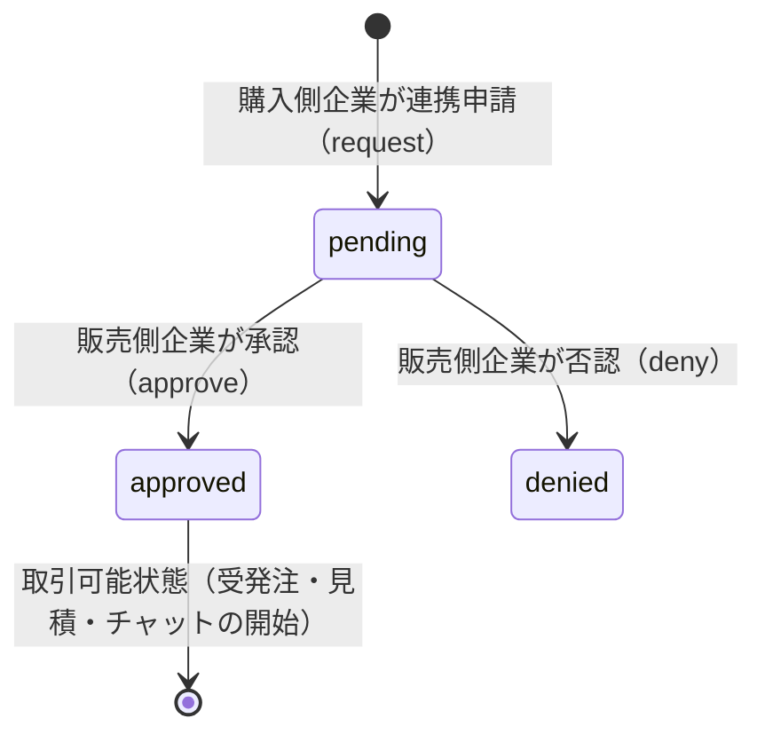

# 機能仕様書: つながり管理（Company Links）

## 1. 概要
MESHuプラットフォームに登録済みの企業同士が、受発注・取引を行うための「つながり（Link）」を申請・承認し、取引ルートを確立・管理する機能です。

---

## 2. 画面一覧・ルーティング

| 画面名 | パス | メソッド | 説明 |
| :--- | :--- | :--- | :--- |
| **つながり一覧** | `/link` | GET | 提携中（承認済）・申請中・承認待ちの取引先一覧 |
| **取引先企業検索** | `/link/search` | GET | 法人番号、企業名、地域等で登録企業を検索（停止中企業は除外） |
| **取引先企業詳細** | `/link/show/{id}` | GET | つながり申請前の取引先候補企業の詳細情報閲覧 |
| **つながり申請** | `/link/request` | POST | 選択した企業へ取引連携（つながり）申請を送信（通知メール配信） |
| **申請完了** | `/link/request-complete` | GET | 申請完了メッセージの表示 |
| **つながり詳細** | `/link/detail/{id}` | GET | つながり状態、担当従業員一覧の確認 |
| **ステータス更新** | `/link/status/{id}` | POST | 申請の承認（`approved`）または否認（`denied`）（通知メール配信） |
| **担当従業員割当** | `/link/assign-users/{id}` | POST | つながり側から自社担当従業員を複数紐付け更新 |

---

## 3. 主要機能仕様

### 3.1. つながりライフサイクルとステータス

- `pending`（申請中）: 申請側には「申請中」、相手側には「承認待ち」として表示。
- `approved`（承認）: 双方間で取引・案件作成およびチャットが可能になります。
- `denied`（否認）: 取引不可。

### 3.2. 検索・除外条件
- 取引先企業検索（`/link/search`）では、以下の企業は自動的に検索結果から除外されます。
  1. 自社自身（自己取引防止）
  2. アカウントステータスが `suspended`（停止中）または `deleted`（削除済）の企業
  3. すでに申請中（`pending`）または承認済（`approved`）のつながりが存在する企業

### 3.3. 担当者割り当て（双方向同期）
- つながり詳細画面（`/link/detail/{id}`）から、その取引先を担当する従業員をチェックボックスで複数選択・保存可能。
- 従業員管理側（`/users/assign-links/{id}`）からの割当操作と完全に同期（交差テーブル `user_assigned_links` で管理）。

### 3.4. 通知メール配信（Mailable）
- 申請時: `CompanyLinkRequestedMail`（相手先企業の管理者・担当者へ配信）
- 承認時: `CompanyLinkApprovedMail`（申請元企業の管理者・担当者へ配信）
