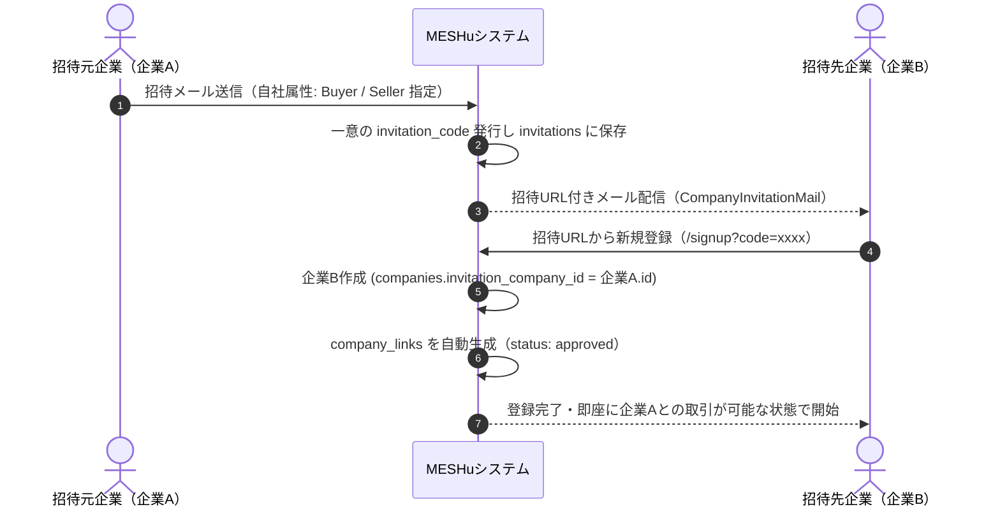

# 機能仕様書: 招待管理（Invitations）

## 1. 概要
MESHuに未登録の取引先企業に対し、企業管理者が招待メールを送信し、招待経由で新規登録された際に自動的につながり（`company_links`）を生成する機能です。

---

## 2. 画面一覧・ルーティング

| 画面名 | パス | メソッド | 説明 |
| :--- | :--- | :--- | :--- |
| **招待履歴一覧** | `/invitation` | GET | 自社から送信した招待履歴一覧・ステータス表示 |
| **新規招待作成** | `/invitation/new` | GET | 招待先企業名、法人番号、担当者名、メール、自社属性の入力 |
| **招待確認** | `/invitation/confirm` | POST | 入力内容および法人番号重複チェックの検証 |
| **招待送信** | `/invitation/send` | POST | 招待メール送信・トークン（`invitation_code`）発行 |
| **招待送信完了** | `/invitation/complete` | GET | 送信完了画面の表示 |
| **招待詳細** | `/invitation/show/{id}` | GET | 送信済み招待内容・URL・登録状況の確認 |
| **招待削除** | `/invitation/delete/{id}` | POST | 招待の取り消し・削除 |

---

## 3. 主要機能仕様

### 3.1. 招待メール送信と法人番号重複制御
- 招待フォーム入力時に法人番号（13桁）が入力された場合、既にMESHuに登録済みの企業が存在するかを検証。
  - 既に登録済みの場合は、招待ではなく「つながり申請（`/link/search`）」を行うよう案内を表示。

### 3.2. 招待経由登録と自動つながり生成フロー

### 3.3. 属性（Buyer / Seller）に応じた自動リンク生成
- 招待元が「購入側（`buyer`）」として招待した場合：
  - `company_links.buyer_company_id` = 招待元企業
  - `company_links.seller_company_id` = 招待先新規企業
- 招待元が「販売側（`seller`）」として招待した場合：
  - `company_links.buyer_company_id` = 招待先新規企業
  - `company_links.seller_company_id` = 招待元企業
- 生成されたつながりは最初から **`status = 'approved'`（承認済み）** となり、即座に取引を開始できます。

### 3.4. 招待元企業IDの追跡（`invitation_company_id`）
- `companies` テーブルに `invitation_company_id` カラムを保持。
- どの企業からの招待によって登録されたかを永続的にトラッキング可能です。
