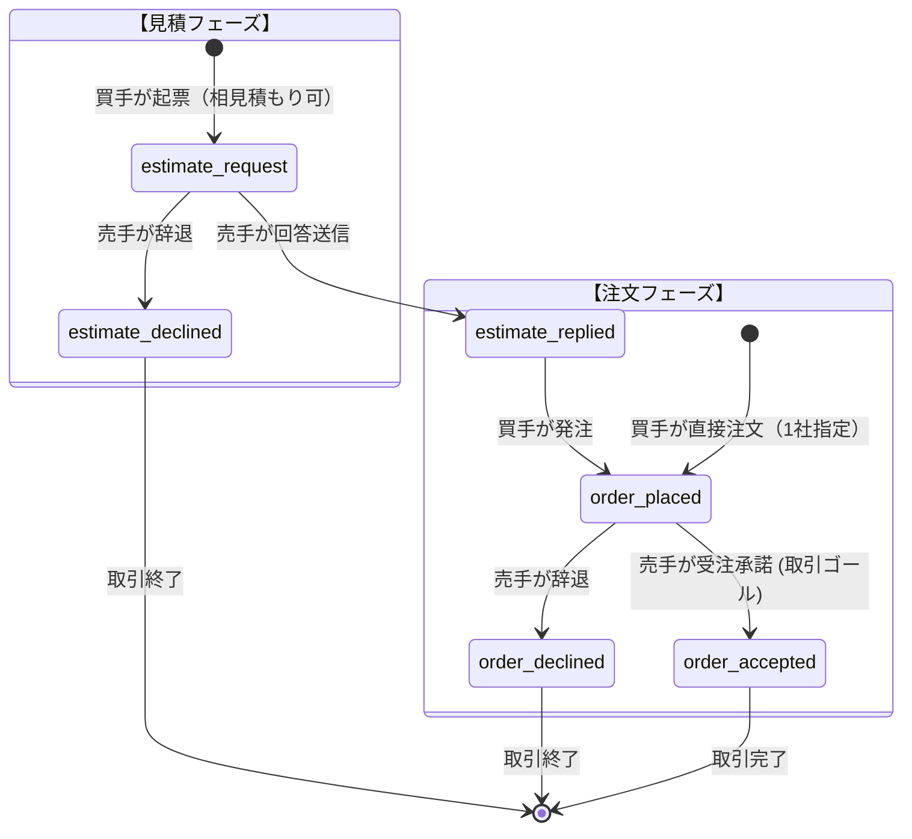

# 機能仕様書: 取引管理（見積・注文・回答・計算・可視性制御・帳票印刷）

## 1. 概要
購入側（買手）と販売側（売手）の間で行われる一連の取引（見積依頼、見積回答、注文、注文回答、および各種辞退）を管理するMESHuの基幹モジュールです。
ビジネスロジックは `TransactionService`、通知配信制御は `TransactionNotificationService` にカプセル化されています。

---

## 2. 取引ライフサイクルとステータス定義

---

## 3. 金額・明細の可視性制御ポリシー（重要）

### 3.1 「見積（`estimate_request`）」段階のルール
- **売手の権限**:
  - 買手の要望（手書きスキャンやURL、添付ファイル、メモ）に基づき、明細行の修正・増減、正式型番・品名の補正、添付ファイルの登録・削除、単価入力、送料、値引き、非課税設定を自由に行い保存可能。
- **買手側の可視性**:
  - **買手入力可能項目（品名・明細行の増減・数量・単位・添付ファイル・備考等）**: 売手が修正・追加した内容を **即座に閲覧可能**（買手は売手が明細を起こし整えてくれた内容を確認できる）。
  - **金額に関わる項目（単価・行金額・送料・値引き額・税抜小計・消費税額・税込合計金額）**: **完全非表示（買手には一切見えない / 回答待ち表示）**。
  - 売手が明細保存した時点では買手への回答通知メール/通知は行わない（正式な回答送信時に通知）。

### 3.2 「見積回答（`estimate_replied`）」へのステータス変更時
- 売手が詳細画面から「見積回答を送信」を実行。
- ステータスが `estimate_replied` に更新され、買手へ通知が送信される。
- **買手側の可視性**:
  - **全項目が公開**（明細、単価、数量、送料、値引き額、小計、消費税額、合計金額）。

### 3.3 「見積回答（`estimate_replied`）」後の再交渉・金額修正ルール
- 見積回答後にコメントや電話等で金額・数量の再交渉が発生した場合、売手は再度内容を編集可能。
- `estimate_replied` 状態での編集保存は、**即座に買手側画面に反映**され、買手は最新の見積条件を確認できる。
- 買手が内容に合意した場合、「注文（`order_placed`）」を実行する。

---

## 4. 計算および端数処理仕様

### 4.1 計算式
1. **明細行金額**:
   $$\text{amount} = \text{rounding}(\text{quantity} \times \text{unit\_price}, \ \text{companies.amount\_rounding})$$
2. **税抜小計**:
   $$\text{subtotal\_amount} = \sum(\text{items.amount}) + \text{shipping\_fee} - \text{discount\_amount}$$
3. **消費税額**:
   $$\text{tax\_amount} = (\text{is\_tax\_exempt} == 1) \ ? \ 0 : \text{rounding}\left(\text{subtotal\_amount} \times \frac{\text{tax\_rate}}{100}, \ \text{companies.tax\_rounding}\right)$$
4. **税込合計金額**:
   $$\text{total\_amount} = \text{subtotal\_amount} + \text{tax\_amount}$$

※端数処理（`round`: 四捨五入, `floor`: 切り捨て, `ceil`: 切り上げ）および適用税率は、**販売側企業（売手）の `companies` 設定** を基準として計算されます。

---

## 5. 帳票印刷機能（`TransactionPrintController`）
- **エンドポイント**: `GET /transactions/print/{id}/{docType?}`
- **対象帳票**:
  - `estimate`: 見積書（買手宛て）
  - `order`: 発注書（売手宛て）
  - `acceptance`: 受注承諾書（買手宛て）
- **仕様**:
  - 印刷用CSS（A4縦対応、プリント時ナビゲーション非表示、改ページ制御）
  - 発行企業情報、取引先企業情報、認証マーク、明細一覧、消費税額・合計金額、備考を出力

---

## 6. 画面一覧・ルーティング

| 画面名 | パス | 実行主体 | 説明 |
| :--- | :--- | :--- | :--- |
| **購入取引一覧** | `/buy` | 買手 | 自社が買手の取引一覧、見積・注文起票ボタン |
| **新規見積依頼** | `/buy/estimate/new` | 買手 | 相見積もり先複数選択、明細/添付ファイル入力 |
| **新規注文依頼** | `/buy/order/new` | 買手 | 1社指定直接発注、明細/添付ファイル入力 |
| **購入取引詳細** | `/buy/show/{id}` | 買手 | 取引詳細、注文実行ボタン、取引コメント |
| **販売取引一覧** | `/sell` | 売手 | 自社が売手の取引一覧、ステータス絞り込み |
| **販売取引詳細** | `/sell/show/{id}` | 売手 | 取引詳細、見積回答作成、注文回答実行、取引コメント |
| **見積回答作成** | `/sell/reply/{id}` | 売手 | 明細編集、単価・送料・値引き入力、回答送信 |
| **帳票印刷** | `/transactions/print/{id}/{docType?}` | 双方 | 見積書・発注書・承諾書のブラウザ印刷/PDF出力 |
| **添付ダウンロード** | `/transaction/attachment/{id}` | 双方 | 取引添付ファイルのバイナリダウンロード |
| **取引コメント投稿** | `/transaction/comment/{id}` | 双方 | 取引スレッドへの連絡コメント投稿 |
