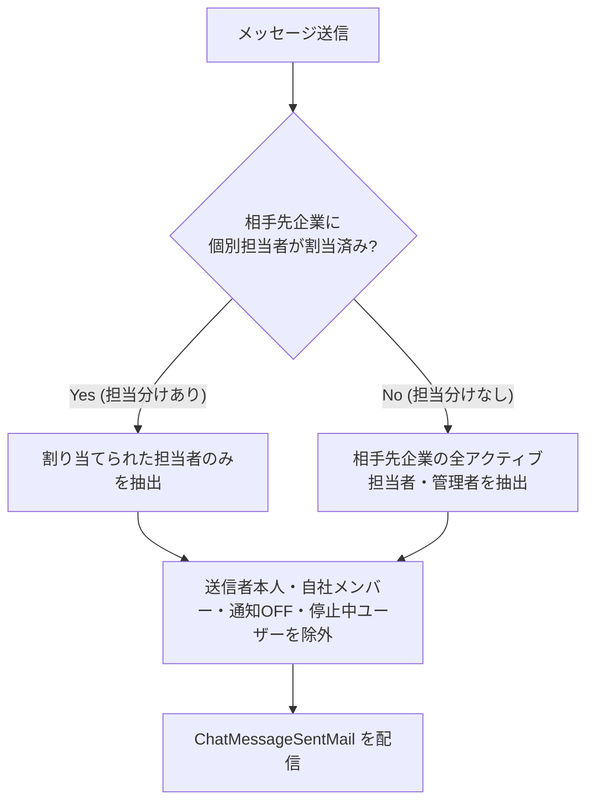

# 機能仕様書: チャット機能（つながり企業間メッセージ・メール通知）

## 1. 概要
承認済みの取引先企業（`company_links.status = 'approved'`）と 1対1（企業対企業）のチャットルームを通じて、リアルタイムなメッセージ送受信、ファイル共有、既読確認、および未読メール通知を行うコミュニケーション基盤です。

---

## 2. ルーム構成とアクセス制御仕様

### 2.1. ルームの成立条件
- 企業間で「つながり（`company_links`）」が承認済み（`approved`）であること。
- 1つの `company_link` に対して 1 つのチャットスレッド（ルーム）が紐付きます。

### 2.2. 担当者権限とアクセス制御
- **全取引先担当者（`is_all_assigned = 0`）**: 自社の承認済みつながり企業すべてのチャットルームにアクセス可能。
- **担当分け従業員（`is_all_assigned = 1`）**: `user_assigned_links` で自身が割り当てられている取引先企業のルームのみアクセス可能。非担当のルームにアクセスした場合は 403 Forbidden。
- **相手先企業の担当者表示**: 相手先企業に所属するアクティブユーザー一覧を右側サイドパネルに表示。

---

## 3. メッセージ送受信・操作仕様

### 3.1. メッセージ送信
- **エンドポイント**: `POST /chat/{link_id}/message`
- **入力項目**: 本文（`message_body`）または 添付ファイル（`attachment`）。いずれか必須。
- **ファイル添付**:
  - 容量上限: 1ファイルあたり **最大20MB**。
  - 格納方式: PostgreSQL `BYTEA` バイナリ直接保存（`chat_message_attachments` テーブル）。
- **送信時処理**:
  - メッセージ登録（`chat_messages`）
  - 送信者自身の既読ステータス更新（`last_read_message_id = 最新ID`）
  - 相手先担当者へのメール通知発行（`ChatNotificationService`）

### 3.2. 添付ファイルダウンロード
- **エンドポイント**: `GET /chat/attachment/{attachment_id}`
- **動作**: 該当メッセージが所属するルームへのアクセス権限を検証し、PostgreSQL `BYTEA` ストリームから安全にダウンロード配信。

### 3.3. 既読管理
- **テーブル**: `chat_read_statuses` (複合主キー: `company_link_id, user_id`)
- **仕様**:
  - ルーム表示時に、該当ユーザーの `last_read_message_id` を最新メッセージIDで更新。
  - ルーム一覧では「`last_read_message_id` より新しい相手先メッセージの件数」を未読バッジ（赤丸数字）として表示。

### 3.4. メッセージ削除
- **権限**: 自身が送信したメッセージのみ削除可能。
- **動作**: 論理削除（`deleted_at = NOW()`）。画面上では「このメッセージは削除されました」と薄色・斜体で表示。

---

## 4. メール通知配信マトリクス（`ChatNotificationService`）

### 4.1. 通知先ユーザーの抽出ルール（厳格な担当者振り分け）
相手先企業のアクティブな従業員のうち、以下の条件に基づいて配信先を決定します：

1. **ケースA (全担当配信)**: 相手先企業に `user_assigned_links` が登録されていない場合、相手先企業の全アクティブ担当者・管理者に配信。
2. **ケースB (個別担当限定配信)**: 相手先企業に特定の担当者が割り当てられている場合、その担当者のみに配信。
3. **ケースC (除外制御)**: メッセージ送信者本人、自社メンバー、マイプロフィールでチャット通知をOFF（`notify_chat = 0`）にしているユーザー、停止中ユーザーには配信しない。

### 4.2. メール送信内容
- **Mailable クラス**: `App\Mail\ChatMessageSentMail`
- **件名**: `[MESHu] 【チャット新着】[送信元企業名] [送信者名]様よりメッセージが届きました`
- **本文**:
  - 送信元企業名・担当者名
  - メッセージ本文（プレビュー）
  - 添付ファイル情報（ファイル名・容量）
  - チャットルームへの直接リンクURL
- **テンプレート**: `resources/views/emails/chat_message_sent.blade.php`
