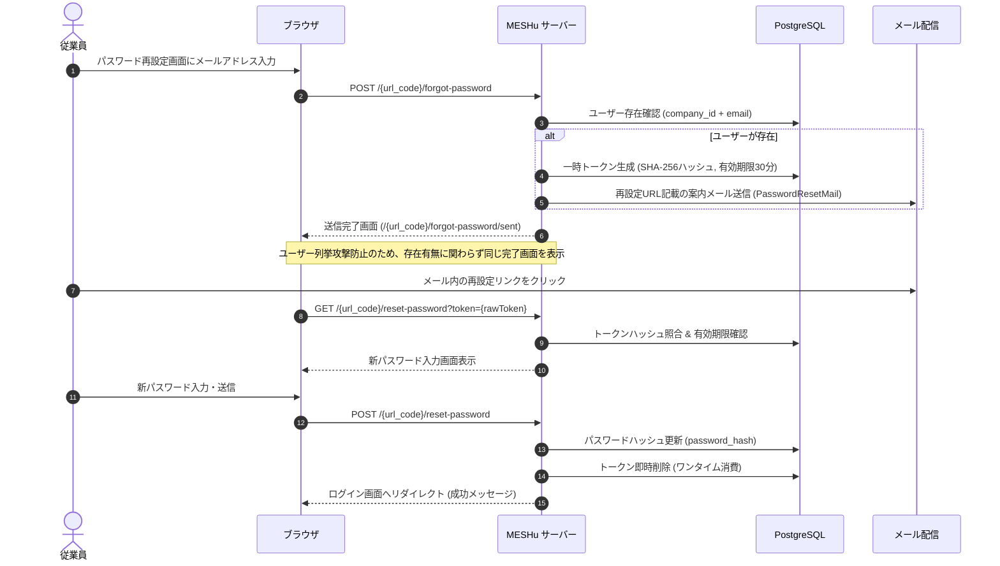

# 機能仕様書: 企業別認証・パスワード再設定（リマインダー）

## 1. 概要
MESHu プラットフォームにおけるマルチテナントURL設計に基づいた「企業別専用ログイン」および安全な「パスワード再設定（リマインダー）」の仕様です。

---

## 2. 企業別専用ログイン（`/{url_code}/login`）

### 2.1. URL構造と識別
- 各企業は一意の識別コード `url_code`（英数字・ハイフン、例: `sample-corp`）を保持します。
- ログインURL: `/{url_code}` または `/{url_code}/login`
- 企業アカウント（`companies`）の `status` が `active` でない場合は 404 Not Found を返却。

### 2.2. アカウント識別と認証処理
- **ログインID**: メールアドレス（`email`）。同一企業内でのみ一意制約（`UNIQUE(company_id, email)`）。
- **パスワード検証**: Laravel `Hash::check()`（Argon2id / BCRYPT）。
- **アカウント有効性**: `users.status = 'active'` のみログイン許可。
- **セッション情報**:
  - `auth:web` による標準ガード認証
  - ログイン後は `/dashboard` へリダイレクト

### 2.3. ログアウト処理（`/logout`）
- ユーザー企業のセッション情報のみを選択破棄（事務局代理ログインセッション等の状態を考慮）。
- ログアウト後は自社のログイン画面 `/{url_code}/login` へリダイレクト。

---

## 3. パスワード再設定（リマインダー）仕様

### 3.1. セキュリティ対策と設計原則
1. **ユーザー列挙攻撃（User Enumeration）防止**:
   - 入力されたメールアドレスが存在しない場合でも、画面上は「再設定メールを送信しました」と表示し、アカウント存在の有無を推測させない。
2. **トークンのハッシュ保管**:
   - 生トークン（64文字ランダム文字列）はメールリンク内のみに含め、DBには SHA-256 ハッシュ値（`token_hash`）のみを保存。
3. **有効期限とワンタイム消費**:
   - 有効期限は発行から30分間。パスワード変更完了時に即座にDBレコードを物理削除。
