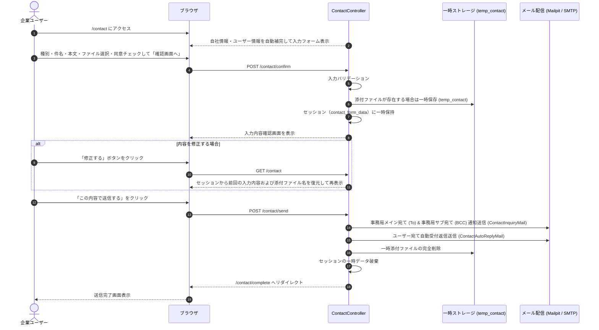

# 機能仕様書: 事務局へのお問い合わせ（Contact Office）

## 1. 概要
MESHu プラットフォームを利用する企業ユーザーが、操作方法・連携・不具合・アカウント変更・システム要望等の相談をシステム運営事務局へ直接送信できるお問い合わせ機能です。
入力・確認・完了の3ステップ遷移、添付ファイルの一時保持と安全なクリーンアップ、および事務局（メイン/サブ）・ユーザー双方への自動メール通知を行います。

---

## 2. 画面一覧・ルーティング

| 画面名 | パス | メソッド | 説明 |
| :--- | :--- | :--- | :--- |
| **お問い合わせ入力** | `/contact` | GET | お問い合わせフォーム入力画面（自社・ユーザー情報の自動補完、FAQ案内） |
| **内容確認** | `/contact/confirm` | POST | 入力バリデーション、添付ファイル一時保存、確認画面表示 |
| **送信処理** | `/contact/send` | POST | 事務局宛て通知送信、ユーザー宛て自動返信、一時ファイル削除、セッション破棄 |
| **送信完了** | `/contact/complete` | GET | お問い合わせ送信完了画面の表示 |

---

## 3. 主要機能仕様

### 3.1. 画面遷移とステップインジケータ
画面上部には `1. 入力` $\rightarrow$ `2. 確認` $\rightarrow$ `3. 完了` のステップインジケータを配置し、現在の進捗を明確に示します。

### 3.2. お問い合わせ種別
以下の6種のお問い合わせカテゴリを選択可能：
1. `operation`: システムの操作方法・使い方の相談
2. `link`: 取引先との連携・申請・承認に関するお問い合わせ
3. `trouble`: エラー・不具合のご報告
4. `account`: アカウント・権限・登録情報の変更について
5. `system`: 機能・仕様に関するお問い合わせ
6. `other`: その他事務局へのお問い合わせ

### 3.3. 入力バリデーションルール
- **お問い合わせ種別 (`contact_type`)**: 必須、上記6種のいずれか。
- **件名 (`subject`)**: 必須、最大255文字。
- **お問い合わせ内容 (`message`)**: 必須、最大5000文字。
- **個人情報同意 (`agree_privacy`)**: 必須（チェックボックスON）。
- **添付ファイル (`attachment`)**: 任意、最大10MB（10,240KB）、対応拡張子: `png`, `jpg`, `jpeg`, `pdf`, `zip`。

### 3.4. 添付ファイルの一時保持とライフサイクル
- **確認画面遷移時**:
  - アップロードされたファイルは `storage/app/temp_contact/` に一意のファイル名で安全に保存。
  - セッション（`contact_form_data`）にファイルパス、元ファイル名、MIMEタイプを記録。
- **修正画面復帰時**:
  - 確認画面から戻った後、ファイルを再選択せずに再送信した場合は、セッション内の既存一時ファイルを引き継ぎ。
  - 新たに別ファイルを選択した場合は、古い一時ファイルを自動削除して新しいファイルで置き換え。
- **送信完了時**:
  - メール送信処理完了後、ストレージから一時ファイルを確実に物理削除（ストレージ枯渇を防止）。

---

## 4. メール送信仕様（Mailable）

### 4.1. 事務局宛てお問い合わせ通知（`ContactInquiryMail`）
- **宛先 (To)**: `config('mail.office.main')`（`.env` の `MAIL_OFFICE_MAIN`、未設定時は `noreply@meshu.org`）
- **BCC (Bcc)**: `config('mail.office.sub')`（`.env` の `MAIL_OFFICE_SUB`、未設定時は `lamusicar@gmail.com`）
- **返信先 (Reply-To)**: 送信ユーザーのメールアドレスおよび氏名（`new Address($user->email, $user->user_name)`）
- **件名**: `【MESHuお問い合わせ】[種別名] 件名 (企業名)`
- **本文**: 送信元企業情報（企業名、ID、送信者名、権限、メール、電話番号）、お問い合わせ種別、件名、本文、添付ファイル情報
- **添付ファイル**: 一時保存されたファイルをメール本体に実バイナリ添付

### 4.2. ユーザー宛て受付自動返信（`ContactAutoReplyMail`）
- **宛先 (To)**: 送信ユーザーのメールアドレス（`$user->email`）
- **件名**: `【MESHu】お問い合わせを受領いたしました`
- **本文**: お問い合わせ内容の控え、回答目安（原則1〜2営業日以内）、事務局受付時間案内

---

## 5. 自動テスト（Feature Test）
`tests/Feature/Tenant/ContactTest.php` において以下の全項目を網羅的に検証：
1. 未ログインアクセスのリダイレクト検証
2. 入力画面表示・自社情報補完・FAQ表示の検証
3. 必須項目漏れバリデーション検証
4. 不正な種別指定のバリデーション検証
5. 文字数超過（件名256文字、本文5001文字）のバリデーション検証
6. 不正な拡張子（`.exe`）および容量オーバー（10MB超）の検証
7. 添付ファイルあり送信フロー、`MAIL_OFFICE_MAIN` / `MAIL_OFFICE_SUB` 配信、一時ファイル削除、セッション破棄の検証
8. 修正画面からの再確認遷移時における添付ファイル情報の保持検証
9. セッション切れ時のハンドリング検証（`/contact/send` 直接アクセス時のエラーリダイレクト）
10. 送信完了画面の正常表示検証
