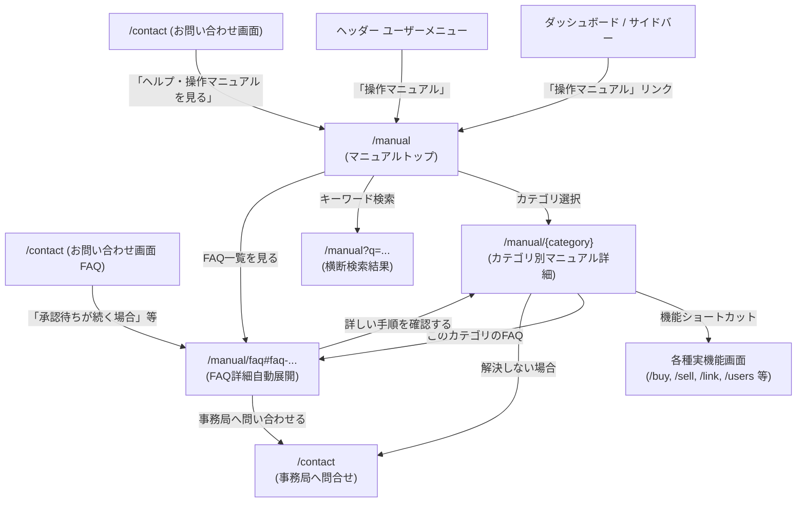

# 機能仕様書: 操作マニュアル・ヘルプ（Manual & Help）

## 1. 概要
MESHu プラットフォームを利用する企業ユーザー（一般社員・管理者）が迷わずシステムを活用できるよう、体系的な「操作マニュアル」「カテゴリ別ガイド」「よくあるご質問 (FAQ)」を提供する統合ヘルプ機能です。
キーワードによる横断検索、カテゴリ別アコーディオン展開、関連機能へのクイックリンクボタン、および困ったときの事務局問い合わせ窓口へのスムーズな導線を備えています。

---

## 2. 画面一覧・ルーティング

| 画面名 | パス | メソッド | 説明 |
| :--- | :--- | :--- | :--- |
| **マニュアルトップ** | `/manual` | GET | 操作マニュアルのトップページ（キーワード検索、カテゴリカード一覧、おすすめFAQ、事務局案内） |
| **カテゴリ別詳細** | `/manual/{category}` | GET | 指定カテゴリのステップ別操作手順・TIPS・関連機能リンク・ページ内目次 |
| **よくあるご質問 (FAQ)** | `/manual/faq` | GET | FAQ一覧画面（キーワード検索、カテゴリ別フィルタタブ、アコーディオン開閉、URLハッシュ自動展開） |
| **ヘルプ転送** | `/help` | GET | `/manual` へのリダイレクトショートカット |
| **FAQ転送** | `/faq` | GET | `/manual/faq` へのリダイレクトショートカット |

※すべてのルートは `auth:web` ミドルウェアによって保護され、ログイン中の全従業員がアクセス可能です。

---

## 3. 主要機能仕様

### 3.1. 画面遷移と連携フロー

---

### 3.2. マニュアルカテゴリ構成

| カテゴリID | タイトル | 主な対象と内容 |
| :--- | :--- | :--- |
| `getting-started` | **はじめてのMESHu** | システムの全体像、自社専用ログインURL、初回パスワード変更・プロフィール確認、ダッシュボードの見方 |
| `links` | **取引先との「つながり」(MESH)** | 企業検索・連携申請、申請の承認・却下フロー、未登録取引先企業の招待手順 |
| `transactions` | **取引管理（購入・販売・帳票）** | 【購入側】見積依頼・直接注文、【販売側】見積回答・注文承諾/辞退、再交渉、コメント機能、帳票印刷 |
| `chat-notices` | **チャットとお知らせ** | 取引先別チャットルーム、ファイル送受信、既読管理・削除、お知らせ一覧・詳細・添付ファイルダウンロード |
| `company-users` | **自社情報と従業員アカウント管理** | 企業情報メンテナンス（住所・連絡先等）、従業員アカウント追加・管理者権限、担当割当（全担当 vs 個別企業担当） |
| `security-contact` | **セキュリティと事務局問合せ** | パスワードリマインダー、認証バッジ（公式マーク）の意義、事務局問い合わせ窓口と対応時間 |

---

### 3.3. よくあるご質問 (FAQ) 仕様

1. **アコーディオン形式**:
   - 質問タイトル（Q.）をクリックすることで回答（A.）がスムーズに展開・格納。
2. **URLハッシュ連動**:
   - `/manual/faq#faq-link-pending` などのハッシュ付きURLでアクセスした場合、JavaScript により対象アコーディオンが自動展開され、該当位置へスムーズスクロール。
3. **カテゴリフィルタとキーワード検索**:
   - 上部のバッジタブで対象カテゴリのみを即時絞り込み。
   - 検索キーワードによる質問文・回答文の横断検索。
4. **マニュアル詳細への相互リンク**:
   - 各FAQの回答末尾に、該当する操作マニュアル（`route('tenant.manual.category', ...)`）への直接リンクボタンを配置。

---

### 3.4. 導線・ナビゲーションの統合

1. **サイドバーメニュー (`layouts.tenant`)**:
   - 「事務局へ問合せ」の下に「操作マニュアル」項目を追加（アイコン: `bi-book-half`）。
   - アクティブ判定: `$activeMenu === 'manual'`。
2. **ヘッダーユーザーメニュー (`layouts.tenant`)**:
   - ドロップダウンメニューの「マイプロフィール」直下に「操作マニュアル」リンクを追加。
3. **お問い合わせ画面 (`contact.index`, `contact.complete`)**:
   - 右側FAQカードのリンク先を `/manual/faq#faq-...` に接続。
   - 「ヘルプ・操作マニュアルを見る」ボタンを `/manual` に接続。
   - お問い合わせ送信完了画面の「ヘルプ・FAQを見る」ボタンを `/manual` に接続。

---

## 4. セキュリティとアクセス制御

- **認証保護**: 企業ログイン（`auth:web`）が必須。未認証アクセスは自社ログインURLまたはトップページへリダイレクト。
- **マルチテナント整合性**:
  - 表示される共通マニュアル情報はセキュアな定数定義に基づき提供。
  - テナント固有情報（自社名、担当者名）は `layouts.tenant` を通じて適切に反映。
- **URL競合の防止**:
  - グローバルURLパラメータ制約（`Route::pattern('url_code', ...)`）に `manual|faq|help` を登録し、テナント専用ログインURLとの衝突を完全防止。
